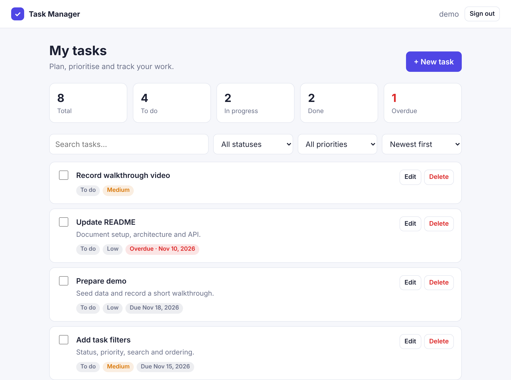

# Task Manager — Django REST Framework + React

A full-stack task manager: a **Django REST Framework** API with JWT
authentication and a **React + TypeScript** single-page app.



> A sibling project implements the exact same API with **FastAPI**:
> [interview-fastapi-react](https://github.com/RToister/interview-fastapi-react). The React
> frontend is identical and works with either backend.

## Features

- Registration and login with JWT bearer tokens
- Task CRUD: each user sees and edits only their own tasks
- Status (`todo` / `in_progress` / `done`), priority, due date, overdue flag
- Filtering, full-text search, ordering (including priority by rank) and pagination
- Dashboard statistics (total, per status, overdue)
- OpenAPI schema with Swagger UI at `/api/docs/`
- Responsive UI with light and dark themes
- Tests for the backend (pytest) and the frontend (Vitest + Testing Library)
- Docker Compose setup with PostgreSQL, CI on GitHub Actions

## Tech stack

| Layer    | Technologies |
| -------- | ------------ |
| Backend  | Python 3.13, Django 6, Django REST Framework, SimpleJWT, django-filter, drf-spectacular |
| Frontend | React 19, TypeScript, Vite, React Router |
| Database | PostgreSQL (Docker / CI), SQLite for quick local runs |
| Quality  | pytest, Vitest, Testing Library, Ruff, ESLint, GitHub Actions |
| Delivery | Docker, Gunicorn, nginx |

## Quick start (Docker)

```bash
docker compose up --build
```

- App: <http://localhost:3000>
- API docs: <http://localhost:8000/api/docs/>

Optional demo data (user `demo` / `demo-pass-123`):

```bash
docker compose exec backend python manage.py seed_demo
```

## Local development

**Backend** (Python 3.12+):

```bash
cd backend
python3 -m venv .venv
source .venv/bin/activate
pip install -r requirements-dev.txt
cp .env.example .env
python manage.py migrate
python manage.py seed_demo
python manage.py runserver
```

**Frontend** (Node.js 22+), in a second terminal:

```bash
cd frontend
npm install
npm run dev
```

Open <http://localhost:5173>. The Vite dev server proxies `/api` to
`http://localhost:8000`, so no CORS configuration is needed locally.

## API

All endpoints except registration, token and health require
`Authorization: Bearer <token>`.

| Method | Endpoint | Description |
| ------ | -------- | ----------- |
| `POST` | `/api/auth/register/` | Create a user |
| `POST` | `/api/auth/token/` | Get an access token (`{"username", "password"}`) |
| `GET` | `/api/auth/me/` | Current user |
| `GET` | `/api/tasks/` | List tasks — `?status=`, `?priority=`, `?search=`, `?ordering=`, `?page=` |
| `POST` | `/api/tasks/` | Create a task |
| `GET` | `/api/tasks/{id}/` | Task details |
| `PATCH` | `/api/tasks/{id}/` | Update a task |
| `DELETE` | `/api/tasks/{id}/` | Delete a task |
| `GET` | `/api/tasks/stats/` | Counts per status and overdue |
| `GET` | `/api/health/` | Health check |

`ordering` accepts `created_at`, `due_date`, `priority`, `title`
(prefix with `-` for descending). Lists are paginated as
`{"count", "next", "previous", "results"}`; validation errors are returned as
`{"field": ["message"]}` with status `400`.

## Tests and linters

```bash
cd backend && pytest && ruff check . && ruff format --check .
cd frontend && npm test && npm run lint && npm run build
```

The same checks run on every push in GitHub Actions; backend tests run
against PostgreSQL there.

## Project structure

```
backend/
  config/        settings, URLs, WSGI
  accounts/      registration, token and current-user endpoints
  tasks/         Task model, serializers, filters, viewset, seed command
  tests/         pytest suite
frontend/
  src/api/       typed API client and shared types
  src/auth/      auth context (token storage, current user)
  src/components/  task list item, form, filters, stats, pagination
  src/pages/     login/register and tasks pages
  src/test/      Vitest + Testing Library tests
docker-compose.yml
.github/workflows/ci.yml
```

## Design notes

- **Ownership is enforced in the queryset** (`Task.objects.filter(owner=request.user)`),
  so another user's task returns `404` rather than leaking its existence with `403`.
- **Priority ordering** uses a `CASE` expression that ranks `low < medium < high`
  instead of sorting the strings alphabetically.
- **Statistics** come from a single aggregate query with conditional `COUNT`s.
- **One API contract for two backends**: token response and error format are
  identical to the FastAPI version, so the same frontend runs on both.
- **Configuration via environment variables**; the app refuses to start in
  production mode without `DJANGO_SECRET_KEY`.
